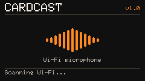
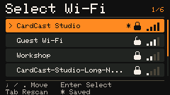
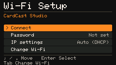
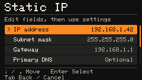
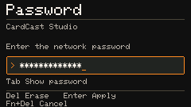

# CardCast

CardCast turns an M5Cardputer into a Wi-Fi microphone, capturing microphone input and streaming it over a Wi-Fi connection to a web page. This allows you to listen to the microphone input from the M5Cardputer remotely through a web browser.




## Features

- Streams microphone audio from M5Cardputer to a web page.
- Captures audio at a sample rate of 16000 Hz.
- Provides a responsive orange/amber audio ribbons with collapsible advanced controls.
- Sends 10 ms PCM frames over WebSocket with bounded capture and playback buffers.
- Automatically reconnects to live audio instead of accumulating delayed playback.
- Configurable via on-screen input for Wi-Fi credentials.
- Automatically turns off the stream screen backlight after 60 seconds without keyboard activity; any keyboard key wakes it.
- Save Wi-Fi credentials on Non-Volatile-Memory for better experience.


## Visual design

Device and browser screens share a charcoal, warm white and orange palette:
background `#121212`, panels `#242424`, separators `#48443F`, primary text
`#F2EDE4`, secondary text `#B6ADA1`, accent `#FF8A24`, warning `#F2C14E`
and error `#FF6961`. Selected device rows and primary browser buttons use dark
text on orange. Arrows, text and error markers also identify states. Browser
control outlines use the secondary text color to meet 3:1 contrast; keyboard
focus and expanded controls use orange. Text contrast is at least 4.5:1.
System monospace fonts fall back to local Chinese fonts; no fonts are downloaded.

`CardTheme` provides RGB565 colors and shared device headings, lists, input boxes,
messages and footers. The home screen shows `CARDCAST`, `v1.0`, a static audio
mark and scan/retry status. The stream page says **Audio server ready** and shows
the full browser address; it does not indicate that a listener is playing.
The browser retains its four audio-responsive ribbons and collapsible controls,
with solid panels and small corners. Its canvas reads CSS colors on initialization
and resize, with no style reads during animation frames.

Device examples (production M5GFX offscreen renders, 240 × 135):
[home](docs/screenshots/home.png), [stream](docs/screenshots/stream.png),
[startup error](docs/screenshots/startup-microphone-failed.png).
Diagnostics are read from production sources by the renderer.

Browser examples (real page in Chrome, simulated PCM audio):
[mobile play prompt](docs/screenshots/web/mobile/play-mobile.png),
[desktop ribbons](docs/screenshots/web/pc/spectrum-1440.png),
[Chinese mobile details](docs/screenshots/web/mobile/advanced-zh-390.png),
[English desktop details](docs/screenshots/web/pc/advanced-en-1440.png).
The gallery keeps 14 device images and 5 browser images. Each page uses one or
two representative states; equivalent error messages and setting values are not
stored separately. Browser images are grouped by device in `web/mobile/` and
`web/pc/`. Both autoplay scenarios use `SCREENSHOT_DIR=docs/screenshots/web`;
the screenshot helper selects the device subdirectory automatically.
Full-page detail screenshots can exceed the viewport height.
See Validation for reproducible generation commands. Physical screen appearance,
real keyboard/Wi-Fi behavior and microphone-to-speaker latency still require
hardware acceptance. Rebuild and flash to apply embedded browser changes.

## Installation

- <b>M5Burner</b> : Search into M5CARDPUTER section and simply burn it
- <b>Old school</b> : Build or take the firmware.bin from the github release and flash it


## Usage

- On startup, the home screen automatically scans for Wi-Fi without a key press, then opens **Select Wi-Fi** as soon as networks are found. If no Wi-Fi is found or scanning fails, the home screen shows **No Wi-Fi found. Retrying...** or **Wi-Fi scan failed. Retrying...** at the bottom and scanning retries after 2 seconds. **Change Wi-Fi** uses the same home-screen scanning flow.
- Configure Wi-Fi: choose a network to open **Wi-Fi Setup**, review its password and IP settings, then select **Connect**. Encrypted networks prompt for a missing password; open networks connect without one.
- Access the Audio Stream : Open a browser and navigate to the local IP adress displayed on the M5cardputer screen.
- On the device's stream page, the backlight turns off after 60 seconds without keyboard activity. Press any keyboard key to restore normal brightness and restart the timer; holding a key keeps the screen on. Audio capture and HTTP/WebSocket services continue while the screen is off. Browser activity does not reset this timer. Home, Wi-Fi setup and startup error screens do not automatically turn off.
- Playback starts automatically when permitted by the browser. If blocked, tap the spectrum's **播放** prompt once to enable audio.
- The default view shows a four translucent orange, amber and warm white ribbons driven by live audio. Open **高级** for playback controls and statistics; **停止** disconnects and releases audio resources.
- The top-right language button shows the current language (**中文** or **English**); click it to switch languages without interrupting playback. On first visit, Chinese browser locales use Simplified Chinese; other locales use English. Your choice is saved for this browser and site address when local storage is available.
- Web output is fixed at 100%, with no volume control. Actual loudness follows your phone/computer system volume.

### Low-latency playback

Build and upload this version with PlatformIO (`pio run`, then
`pio run -t upload` with the device connected). The player HTML, CSS and JavaScript modules
are embedded in the firmware; no separate web server or filesystem upload is
needed. An older M5Burner image will not include these changes.

Use Chrome or Edge on the same LAN, with built-in or wired
audio output. The engineering target is **50–100 ms microphone-to-output
latency** on a stable LAN, not a measured guarantee. Bluetooth audio and busy
Wi-Fi can add substantial delay. Wi-Fi power saving is disabled while running
this firmware, increasing power consumption.

The device captures 160 samples per frame at 16 kHz (10 ms), with separate
capture and network tasks. Its **12-frame capture queue** and **32-frame ACK
window** are independent. A full ACK window pauses sending without discarding
the queue or stopping capture. Only queue overflow or frames older than 120 ms
cause oldest-frame drops. These capacities do not require pre-filling before
sending. An outstanding frame reaching **2000 ms** disconnects the listener;
socket writes retain a **250 ms** failure timeout. Capture and ACK notifications
wake the sender, with a 10 ms fallback. Each HTTPD callback sends at most four
frames and yields after a 2 ms budget checked between frames; an individual
socket write can still take up to its failure timeout. This lets queued audio
catch up after scheduling delays without requiring a larger playback buffer.

Playback receives PCM into a bounded queue, prebuffers **60 ms** by default,
and schedules contiguous 10/20 ms audio blocks. It increases the target by 10 ms
on underrun (up to 80 ms), and reduces it by 10 ms after each 30-second stable
period (down to 40 ms). If total pending playback exceeds **150 ms**, only the
necessary unscheduled oldest frames are trimmed; active audio is not stopped.
A short fade softens discontinuities. A smoothed playback-rate correction of
at most +/-0.5% compensates small capture/output clock drift without regularly
throwing away frames. Under jitter, temporary buffering can exceed the nominal
50–100 ms end-to-end target; continuous sound takes priority over forced drops.

A receive gap alone no longer triggers resynchronization. The page compares
capture timestamps with receive time to estimate **additional** stream delay
relative to the best observed offset. If this exceeds 250 ms following a gap
and scheduled audio has run out, or exceeds 500 ms regardless of the gap, it
requests fresh audio on the existing connection. Unscheduled/old future audio
is discarded while currently playing audio finishes. The server's `synced`
marker separates old TCP-buffered audio from the new stream. Clock offsets are
not synchronized, so this estimate is not absolute transport or acoustic latency.
A silent connection or missing marker still reconnects after 3000 ms without
progress, checked once per second.

The page separates **Missing before arrival** (observed sequence gaps),
**Playback queue trims**, **Stale-stream discards**, and **Buffer underruns**.
It also shows the combined missing/discard percentage over the recent ten
one-second buckets. This is not a network packet-loss rate: a sequence gap can
be a deliberate device-side drop, and TCP can deliver every transmitted byte
while the application skips captured audio. Browser frame counters reset on
Start and exclude intentional Stop/page-exit cleanup and unobservable gaps
across reconnect/sync boundaries. Already-ended nodes do not count as discarded
merely because their JavaScript cleanup callback ran late.

`pio device monitor` (115200 baud) logs disconnect reasons and send errors.
During streaming it also prints `Audio stats` every five seconds from the sender
task, outside capture and HTTPD callbacks. Values are cumulative per `start`
session (including syncs): `captured`, `sent`, `overflow`, `expired`, `reset`, and
`full_ms` (time the ACK window stayed full). `queued` is the snapshot queue size;
`ack_wait_max_ms` is the maximum oldest outstanding frame age when a valid ACK
arrives, not acoustic latency. `work_wait_max_ms`, `send_max_us` and
`queue_age_max_ms` report peak callback wait, socket send duration and oldest
queue age observed when attempting to pop a frame. RSSI accompanies each log.
Growing `full_ms` points to delayed receipt confirmations; high callback/send
waits point to HTTPD or transport stalls. `overflow`/`expired` identify actual
capture queue losses. A larger ACK window tolerates delayed confirmations but
cannot remove forward-path network latency or guarantee uninterrupted audio
through prolonged outages.
Reasons include `ack_timeout`, `audio_idle_timeout`, `send_error`,
`sync_send_error`, `receive_error`, `invalid_message`, and `peer_closed`.

Only one listener is supported. A second listener shows **Device busy** and
retries every second. Once playback starts, switching desktop tabs, moving focus
away or minimizing the browser keeps audio playing and retains the listener slot.
Background transport failures still reconnect automatically; only waveform and
statistics display updates pause until the page is visible again. Returning reuses
the connection and accumulated audio statistics. A page first loaded in the
background waits until it is visible before attempting playback.
Closing or navigating away from the page releases the connection; returning from
the browser's page cache restores playback only if it was active before leaving.
Stop releases the listener slot and cancels retries, including in the background.
If the browser suspends audio, returning to the page attempts to resume it; tap
the spectrum if prompted. A broken transport may report WebSocket code 1006
instead of the device's close reason; use the serial log to investigate.

#### Stream protocol / compatibility

`GET /` now serves the player, rather than an endless WAV response. Existing
clients expecting WAV at `/` must migrate. `GET /player.js` serves the ES module
entrypoint; `/styles.css` and the imported JavaScript modules are also served
from embedded firmware resources. The page works over plain HTTP at the
device's IP address;
HTTPS, AudioWorklet and additional transport libraries are not required.

Connect to `ws://<device-ip>/audio`, then send the text message `start` after
the WebSocket handshake. **Protocol v2** binary messages are exactly **328 bytes**.
This replaces the previous 324-byte layout: reload the page after flashing, and
update custom clients to read the capture timestamp before the samples:

| Bytes | Meaning |
| --- | --- |
| 0–3 | Unsigned 32-bit frame sequence, little endian, wraps at 2^32 |
| 4–7 | Unsigned 32-bit device capture uptime in milliseconds, little endian, wraps at 2^32 |
| 8–327 | 160 signed 16-bit little-endian mono PCM samples, 16000 Hz |

Immediately acknowledge each received frame with a four-byte binary message
containing its sequence in little endian. ACKs confirm receipt, not audible
playback. Sequences continue through dropped frames and can start at any value
on reconnect. Unknown/duplicate ACKs do not advance the outstanding window.
To recover from a delivery gap without reconnecting, send text `sync`, discard
all binary messages until text `synced` arrives, then resume normal playback and
ACKs. The device clears its capture queue and ACK window before sending this
marker. All sends and the reset are serialized in the HTTP server task; frames
after the marker belong to the fresh stream. Do not acknowledge pre-marker
frames during resync. The control messages and four-byte ACK layout are unchanged in v2.
A busy server replies with the text `busy` and closes that connection.
Malformed messages close the connection. Connections without capture output
for three seconds are closed so the page can retry. The former `GET /status` connection diagnostics endpoint has been removed.


### Wi-Fi setup and IP configuration

**Select Wi-Fi** displays four networks at a time, signal bars, an open/closed
padlock and a `*` beside the saved network. The counter and scrollbar show your
position. Long names are shortened in the list and shown in the setup overview.
Use `;` / `.` to move up / down, `Enter` to choose and `Tab` to rescan.




Selecting a network opens **Wi-Fi Setup**, with **Connect** highlighted:

- **Connect / Retry connection**: connect with the current settings. If an
  encrypted network has no password, enter it and press `Enter` to connect.
- **Password**: edit the password. Its status is **Not set**, **Saved**, **Set**
  or **Not required** for open Wi-Fi. Passwords are hidden by default;
  `Tab` toggles visibility, `Del` erases, `Enter` applies, and `Fn + Del`
  cancels without changing the previous value. Long input scrolls within the box.
- **IP settings**: choose **Auto (DHCP)** (default) or **Static IP**.
- **Change Wi-Fi** or `Tab`: discard unsaved edits and return to scanning.

Returning from an editor keeps the corresponding menu item selected. Failed
connections show the reason, then `Enter` returns to **Retry connection** with
all entered values retained. If saving fails after connecting, the device
reports that settings were not saved; press `Enter` to continue to audio startup.

For a network without DHCP, choose **IP settings → Static IP** and enter:

| Field | Example |
| --- | --- |
| IP address | `192.168.1.42` |
| Subnet mask | `255.255.255.0` |
| Gateway | `192.168.1.1` |
| Primary DNS | Leave empty, or enter your network's DNS server |
| Secondary DNS | Optional |

Use addresses supplied by your network administrator; the example IP must be
unused and belong to your network. The gateway must be a different usable host
in the same subnet. Standard contiguous masks from /1 through /30 are supported.
DNS is not required to access the audio server by IP, and no public DNS is added
automatically.

The static IP page is a scrollable list: select any field to edit its prefilled
value. Use `Del` to erase, `Enter` to accept that field, and `Fn + Del` to cancel
that field's edit. DNS fields may be empty. Select **Use settings** to validate
and apply the complete draft. Invalid parameters show a specific error; `Enter`
returns to the affected field. **Cancel** or `Tab` discards the entire static IP
draft. Return to the setup overview and select **Connect**.




Open the address displayed on the device to listen to the stream.

Only the most recently connected network's password and network settings are
saved. Selecting that SSID after a restart restores them. Existing saved Wi-Fi
credentials from older firmware use DHCP by default. Failed connections preserve
the saved configuration and keep the current inputs available for editing and
retrying; selecting another network discards unsaved edits.

To restore automatic addressing, select **IP settings → Auto (DHCP)**, then
**Connect**. To edit settings while streaming, restart the device and enter Wi-Fi
setup again. A successful Wi-Fi connection does not verify gateway reachability
or detect duplicate IP addresses.

### Web development

The `web` directory uses native ES modules and a separate `styles.css`, with no
npm dependencies or bundling step. `player.js` composes the application and owns
page events and the statistics timer. `player-view.js` renders the DOM;
`i18n.js` owns language preferences and translations; `visualizer.js` owns the
audio envelope and canvas. Audio responsibilities are separated into
`protocol.js`, `stream-clock.js`, `frame-stats.js`, `pcm-player.js` and
`stream-controller.js`. Core modules can be imported without starting the page.

When adding runtime resources, update both `board_build.embed_txtfiles` in
`platformio.ini` and the static asset table in `src/WebAssets.cpp`. The server
sizes its route capacity from that table and serves explicit paths with the
appropriate MIME type and `Cache-Control: no-store`. `web/package.json` only
marks the JavaScript as ESM for Node tests; it is not embedded or served.
Static responses use `Connection: close` and explicitly queue session closure
after the body is sent. HTTPD also enables LRU session recycling, with outgoing
audio refreshing its session's activity. This prevents abandoned HTTP keep-alive
connections from indefinitely blocking new `/audio` handshakes when the device's
seven client slots fill up.
Rebuild and flash the firmware after changing web resources. Use the browser
smoke test below to exercise the real modules against simulated audio without
hardware; opening the HTML directly through `file://` is not supported.

### Firmware structure

`main.cpp` coordinates initialization, Wi-Fi setup and audio startup. Hardware
modules expose declarations in headers and keep implementation/state in `.cpp`
files. `CardDisplay` owns the main screens; `CardInput` provides keyboard waits
and text entry. `CardWifiSetup` owns the configuration flow; `CardWifiView`
provides shared device/offscreen drawing functions. `WifiSettings` owns
profile persistence and validation, and `WifiConnection` applies the profile and
returns connection errors without drawing UI. Existing NVS keys are preserved.

`AudioServer` owns HTTPD, capture/sender tasks and the stream session. `WebAssets`
registers the embedded player resources. `AudioStreamState` contains host-testable
capture buffers, queue, ACK window and encoding. `AudioServerStartup` implements
the resource acquisition/rollback order used by the hardware adapter. Socket and
ACK state remain confined to HTTPD; capture queue access is locked, and shared
session/work flags are atomic.

Startup reports microphone, HTTP, route or task failures on the display and
serial port; restart the device to retry. Capture/sender tasks are released only
after both exist. Partial startup is rolled back before showing an error, and the
stream screen appears only after successful startup. Runtime microphone recovery
continues retrying without reusing buffers still owned by the driver.

### Validation

Generate device screenshots with `python3 tools/render_home.py` after installing
the PlatformIO dependencies (`pio run`). This requires a host C++ compiler and
Python Pillow. It compiles the production `CardDisplay` and `CardWifiView` drawing
code with M5GFX and exports 240 × 135 PNG originals to `docs/screenshots/`.
Home, scan-retry, stream and Wi-Fi images are regenerated with the shared theme. Wi-Fi fixture inputs in
`tools/wifi_render_states.h` use fixed simulated networks, passwords and IP
addresses; these are offscreen renders, not photographs or live Wi-Fi captures.

Representative Wi-Fi screenshots:

- [Network selection](docs/screenshots/select-wifi.png).
- Setup with [DHCP](docs/screenshots/wifi-setup.png) or
  [static IP](docs/screenshots/wifi-setup-static.png).
- Password [hidden](docs/screenshots/wifi-password.png) or
  [visible](docs/screenshots/wifi-password-visible.png).
- [IP mode](docs/screenshots/wifi-ip-mode.png),
  [static fields](docs/screenshots/wifi-static-fields.png) and
  [address editor](docs/screenshots/wifi-ip-edit.png).
- [Connecting](docs/screenshots/wifi-connecting.png) and
  [connection failure](docs/screenshots/wifi-connect-failed.png).

The renderer still exercises all 41 device fixtures, including stream wakeup, both scan retry
messages and all startup failures, but saves only 14 representative images.
Browser smoke tests still check both autoplay modes, all viewport/language
combinations, Stop, reconnection and keyboard focus; only 5 images are saved.
The home gallery includes [scanning](docs/screenshots/home.png) and
[retrying](docs/screenshots/home-no-networks.png).

The same renderer command also runs `test/card_display_test.cpp` against production
display code and M5GFX. It checks the 60-second idle boundary, activity and held keys,
repeated sleep/wake cycles, timer wraparound, unchanged brightness writes while idle,
and disabled sleep on home/error screens. The wakeup fixture verifies that the stream
framebuffer is unchanged after sleeping and waking; it shares the representative
[stream screenshot](docs/screenshots/stream.png) with the initial view. Offscreen
renders do not simulate backlight brightness and cannot prove physical blackness.
On hardware, check that the screen turns fully off after 60 seconds, ordinary and
modifier keys wake it, and continuous browser playback survives multiple sleep/wake
cycles. Rebuild and flash the firmware to apply this behavior.

The host UI test runs the production setup and keyboard loops against scripted
keys and Wi-Fi responses. It covers credential restore, password apply/cancel,
open networks, scrolling/rescan, scan retries, static drafts and validation,
connection retry, save failure and Enter held across page transitions:

```sh
c++ -std=c++11 -Wall -Wextra -Werror -pedantic -Itest/wifi_fakes -Isrc \
  test/wifi_setup_test.cpp src/CardWifiSetup.cpp src/CardInput.cpp -o /tmp/cardcast-wifi-test
/tmp/cardcast-wifi-test
```

Screenshots and host tests do not validate physical backlight appearance,
keyboard timing, real Wi-Fi authentication or persistence across device resets.
These remain hardware acceptance checks, including DHCP/static connections,
incorrect passwords, changing networks and restart/restore.

Build the firmware with `pio run`. Run the host-side IPv4 validation tests with:

```sh
c++ -std=c++11 -Wall -Wextra -pedantic test/network_validation_test.cpp -o /tmp/cardputer-network-test
/tmp/cardputer-network-test
```

Startup failure injection checks rollback after HTTP, route and worker creation
failures, verifies workers cannot activate early, and retries each failed attempt:

```sh
c++ -std=c++11 -Wall -Wextra -pedantic test/audio_server_startup_test.cpp -o /tmp/cardputer-startup-test
/tmp/cardputer-startup-test
```

The transport regression test compiles the firmware's actual HTTP/WebSocket
handlers against host fakes. It models HTTPD's seven-session limit, reproduces
blocked connection admission with LRU disabled, and checks slot recovery,
static-response closure, audio transmission, busy listeners and reconnection:

```sh
c++ -std=c++11 -Wall -Wextra -Werror -pedantic -Itest/fakes test/audio_server_transport_test.cpp -o /tmp/cardputer-transport-test
/tmp/cardputer-transport-test
```

This test does not emulate FreeRTOS scheduling, microphone hardware or Wi-Fi.

Audio ownership, queue limits, stale-frame rejection, ACK timeouts, timer/sequence
wraparound and packet encoding have host-side tests. Independent continuous
capture with 5–300 ms ACK round trips must deliver all 1000 frames in ten seconds.
The transport test also defers production send callbacks by 1/12/20 ms, verifies
all 1000 frames arrive in order after draining the tail, and covers batch/time
limits, failed work submission, stale callbacks across sync/reconnect, saturation,
queue expiry and send failure. Hardware acceptance still requires at least ten
minutes of continuous playback while comparing serial counters with browser
missing frames, plus a separate acoustic latency and listening check.
Player tests cover four-frame bursts without cancellation, bounded partial
trimming, delayed cleanup callbacks, and 30 virtual minutes of +/-500 ppm source
clock drift without drops or underruns. Browser playback and
connection lifecycle tests require Node.js 22 or newer:

```sh
c++ -std=c++11 -Wall -Wextra -pedantic test/audio_stream_test.cpp -o /tmp/cardputer-audio-test
/tmp/cardputer-audio-test
node --test test/player_test.js test/language_test.js test/visualizer_test.js
SCREENSHOT_DIR=docs/screenshots/web node test/browser_smoke_test.js
AUTOPLAY=allow SCREENSHOT_DIR=docs/screenshots/web node test/browser_smoke_test.js
```

The browser commands use installed `google-chrome` (override with `CHROME_BIN`)
in headless mode. The test serves the real page against simulated PCM over
WebSocket and continuously generates PCM even when sending is blocked. It delivers batches
roughly every 40 ms and delays ACK processing by 60 ms, checking that baseline
playback has no drops or underruns. It also tests 150–750 ms delivery outages,
a 400 ms browser main-thread stall, stale-audio recovery, prolonged-outage
reconnection and Stop. Both blocked and permitted autoplay are
covered, together with module/CSS loading, page lifecycle event wiring,
Stop preservation on return, 60 seconds of real hidden-tab audio scheduling/ACKs
and background reconnection, collapsed advanced controls, fixed volume, reduced motion and
360/390/768/1440 px plus landscape layouts. Set `SCREENSHOT_DIR` to retain page
screenshots. Desktop Chrome/Edge still need audible playback checks while switching tabs and
minimizing/restoring the window; headless simulation does not establish physical
audio continuity. Mobile background/lock-screen playback is outside this change.
Real Android Chrome and iPhone Safari still need device acceptance
for first-visit audio unlock, backgrounding and return to playback. The test uses
a temporary browser profile and requires no npm packages. It does not exercise
the physical ESP32 microphone or establish acoustic latency.

For hardware acceptance, play continuously for 30 minutes in both Chrome and
Edge; check stable memory and no growing delay. Test Wi-Fi interruption, browser
main-thread stalls, hiding/restoring the page, repeated Start/Stop and a second
listener. After recovery, playback should return to current sound instead of
replaying the outage. Check the server page remains accessible during playback.

To measure end-to-end latency, use a synchronized two-channel recorder: one
channel captures a reference pulse near the Cardputer microphone and the other
captures the computer output. Measure corresponding pulse offsets for at least
30 pulses, accounting for any acoustic path difference. Record median and P95;
the stable-LAN acceptance target is P95 <= 100 ms using wired/built-in output.
Compilation and simulated tests alone do not establish this result.

Hardware checks: connect to a DHCP-disabled access point using a static address,
play audio from a browser, restart and reuse saved settings, then switch back to
DHCP. Also check incorrect passwords, connection timeouts, retry/edit operations,
and loading settings saved by older firmware. These require a physical device.
